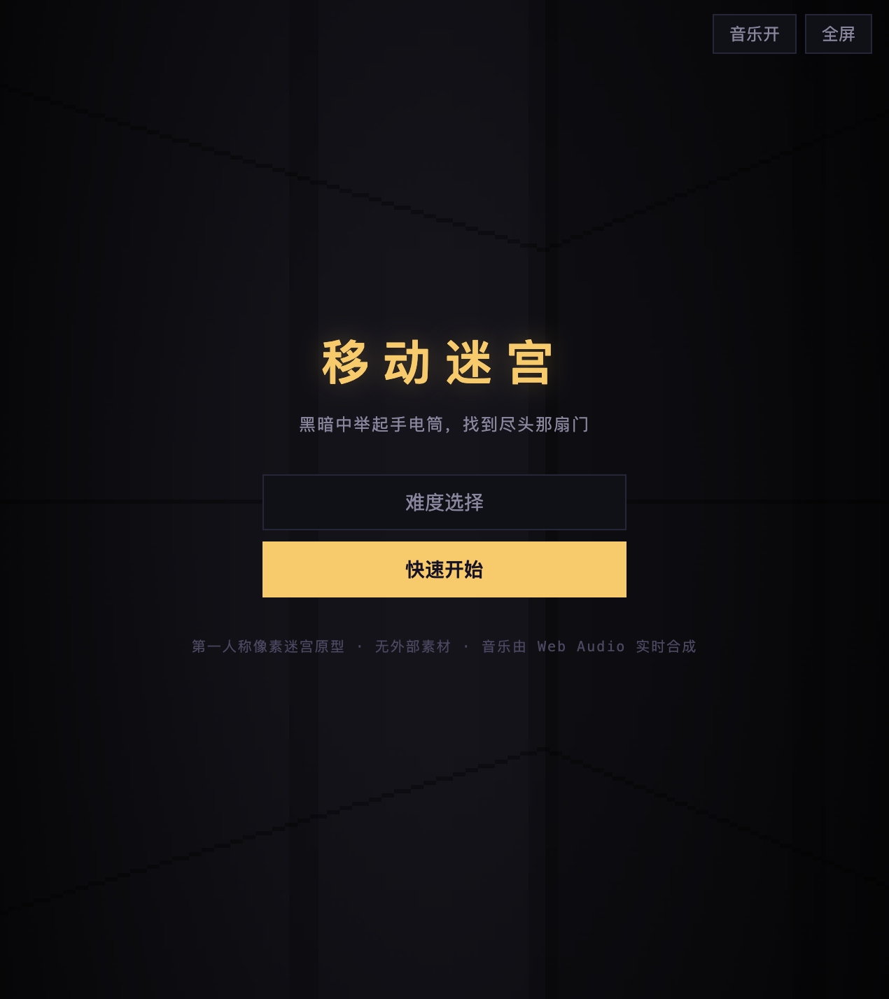
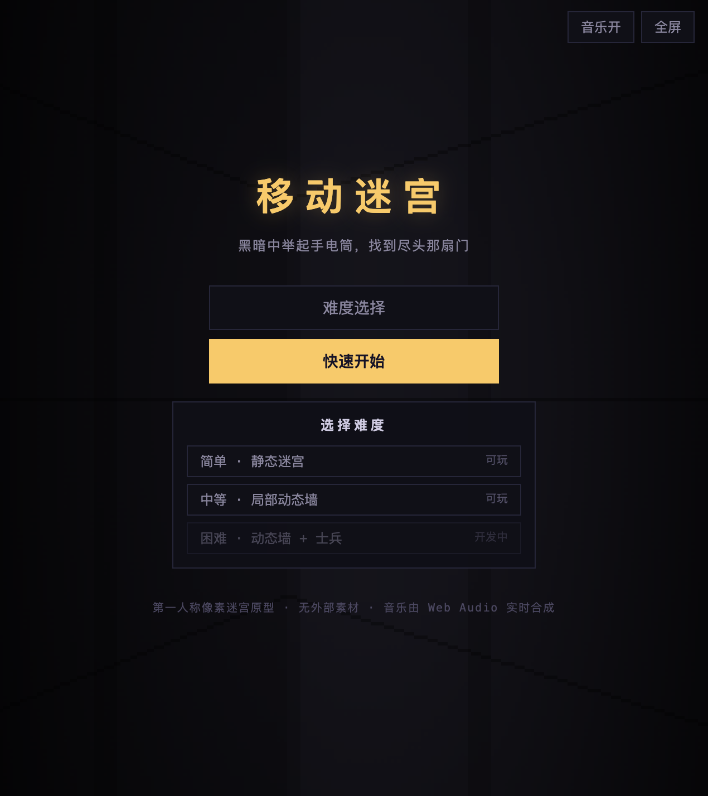
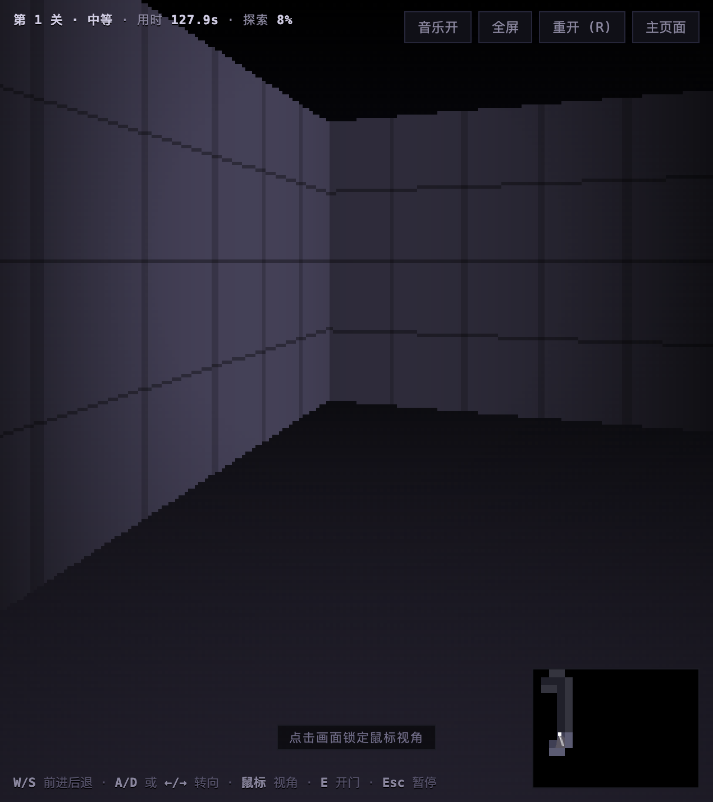
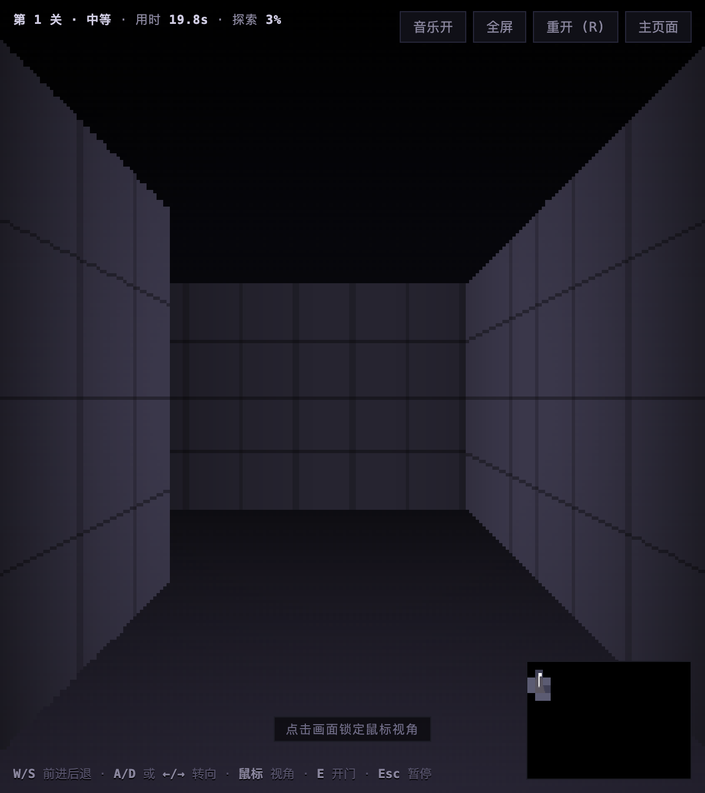
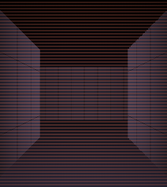
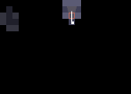
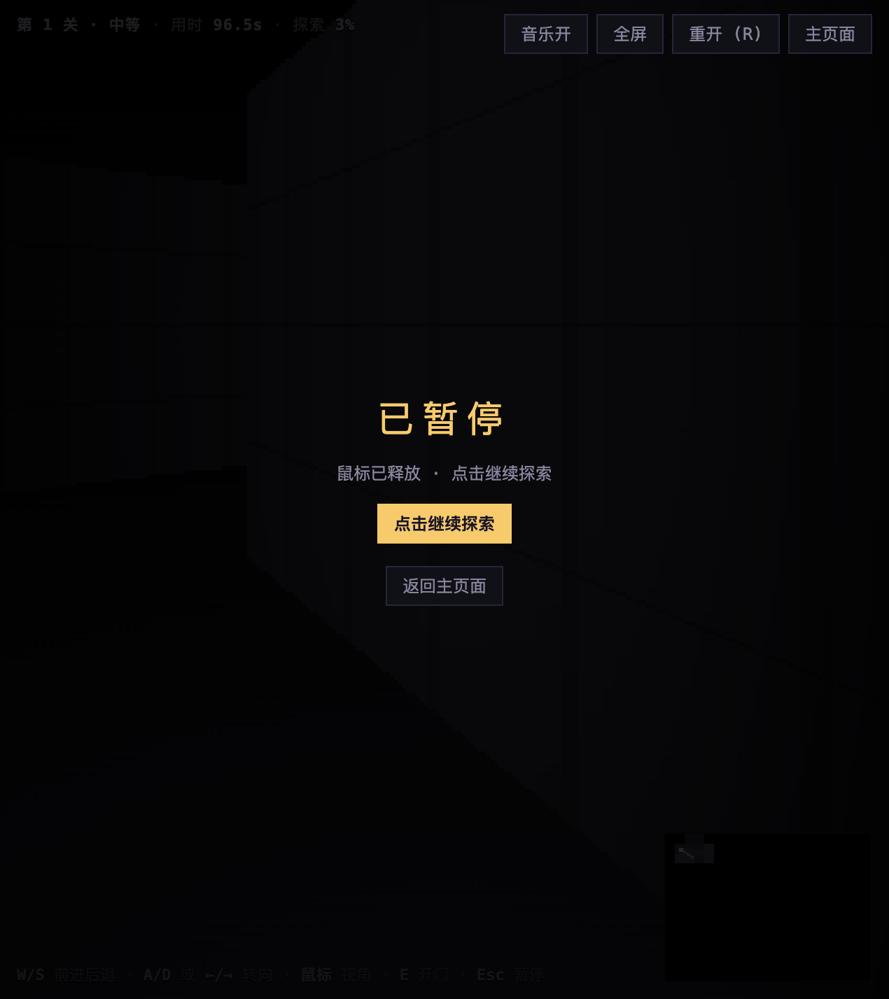

# 【2026 Qoder 高校创造力大赛】移动迷宫：全黑里只靠一把手电筒和一张迷雾小地图，三分钟找到尽头那扇门

> 提交前须知（发帖时删除本段）：
> 1. 把 `screenshots/` 下 7 张图按「图 1–图 7」顺序上传到论坛编辑器，替换正文中的 `` 占位行；
> 2. 全文搜索「待填」，补上自我介绍、Qoder 昵称、组队信息；
> 3. 建议再补 1–2 张你与 Qoder 的对话截图作为过程凭证（平台偏好对话凭证）；
> 4. 发布地址：天池平台赛题页论坛；截止 2026-11-30 18:00。

## 〇、提交信息

| 项目 | 内容 |
| --- | --- |
| 参赛赛道 | LifeHack 生活娱乐（浏览器里玩 3 分钟的东西） |
| 作品名称 | 移动迷宫 |
| 作品链接 | https://moving-maze-m5yhs77zdar.qoder.zone （Qoder Sites 部署，访问策略 public，点开即玩） |
| 作者 / 团队 | 【待填：姓名/队名】，个人参赛：我负责需求、验收与发布，Qoder 负责实现、验证与部署 |
| 所用 Qoder 账号 | 【待填：你的 Qoder 昵称或账号 ID】 |

## 一、自我介绍

【待填：学校 + 专业 + 年级，一句话说明你为什么参赛。示例：某某大学某某专业本科生，平时喜欢做小游戏和前端玩具，想借大赛把「能跑的 demo」逼成「能玩、能验证、能上线的完整作品」。】

## 二、我的作品是什么

一句话：**一个在浏览器里玩 3 分钟的像素逃生小游戏——玩家在完全黑暗的迷宫里只靠一把手电筒和一张「只画你亲眼见过之处」的迷雾小地图，找到并打开尽头那扇门；中等模式下迷宫的墙还会每 12 秒偷偷改道一次。**

- 谁在用：任何打开链接的人，桌面浏览器 + 键盘鼠标即可，无需安装、无需注册、无外部素材。
- 三个记忆点：① 纯前端零素材——画面是 raycasting 伪 3D，音乐是 Web Audio 实时合成；② 战争迷雾小地图——未探索区域是纯黑，绝不透视，出口只有被亲眼看到才标记；③ 中等模式动态墙——事务式切换（先验证再预警再动画再提交），改道但绝不把玩家困死。

## 三、为什么做

1. **从一个「能跑但不好玩」的原型出发。** 仓库里最初只有一个单文件 PrivacyMaze 原型：能走能赢，但没有主页面、没有光照氛围、没有完整流程。我想借大赛的截止日期，把它升级成一个真正可玩、可验证、可公网访问的完整作品。
2. **「黑暗与可见」的主题表达。** 迷宫里你只能看到手电筒照亮的那几格墙，小地图只记录你亲眼见过的格子，中等模式的墙还会在你看不见的地方悄悄变化——我想让玩家在三分钟里亲身体会「信息不对称」的压迫感，和用脚步把整张地图一点点照亮的成就感。这也是 PrivacyMaze 这个名字的延续：可见性本身就是需要被探索和保护的东西。
3. **验证 AI 结对编程的工程下限。** 我的目标不是「让 AI 做个 demo」，而是用工程标准交付：自动化验证脚本、真实浏览器端到端验证、公网部署与线上核对，每一步都有可复跑的证据。

## 四、怎么用（评委照做即可）

1. 桌面 Chrome/Edge 打开 https://moving-maze-m5yhs77zdar.qoder.zone （建议窗口最大化）。
2. 点「快速开始」进入简单模式；或点「难度选择」→「中等 · 局部动态墙」体验动态改道（「困难」明确标注开发中、按钮禁用）。
3. 点击游戏画面锁定鼠标：鼠标转视角，`W/S` 前进后退、`A/D` 或方向键转向；`Esc` 暂停，点击「继续探索」恢复。
4. 跟着手电筒光与右下角迷雾小地图走到地图尽头，**靠近大门、面向大门**时出现提示，按 `E` 开门通关；通关后可「下一关」或「返回主页面」。
5. 中等模式留意屏幕与小地图上的橙红色脉冲预警：约 2 秒后那里的墙会生长/消退改道；`M` 或右上角按钮开关音乐（偏好会记住）。

## 五、用 Qoder 做出来的过程

### 1. 我写需求与验收标准，Qoder 先讨论再动手
我给出十章需求书（铺满窗口、鼠标视角与受限 pitch、手电筒光照规则、迷雾小地图光束、主页面状态机、大门保护区、环路地图、中等模式动态墙的安全不变量、音乐约束、验收清单），并明确红线：**不重写真 3D 引擎、不用外部素材、不把未执行的测试写成通过、找不到合法方案就跳过不死循环**。Qoder 先检查现有代码、讨论机制与风险，再按默认方案增量实施，不推倒重建。

### 2. 交给 Qoder 的部分
- **实现**：raycasting 渲染与整数倍率铺窗布局（抽成纯函数模块便于单测）、Pointer Lock 鼠标视角 + 与帧率无关的指数平滑、逐列手电筒光照（光不穿墙）、`visible/explored/observed` 三层迷雾数据与被墙截断的小地图扇形光束、主页面与四相位状态机、Web Audio 合成背景音乐、嵌墙大门与固定保护区、环路地图生成 + 有限重试 + 固定模板回退、中等模式事务式动态墙（副本检查 → 预警 → 按玩家最新位置复验 → 并集图动画 → 原子提交 + 闪光）。
- **验证**：编写并真实运行 `scripts/validate.ts`——100 张固定种子 **54,435 项检查**、500 张种子 **61,235 项**全通过；动态墙 **720 周期 fuzz**（719 次提交、1 次复验取消，每次提交断言玩家→大门可达、不压碰撞体、保护区不变）；真实浏览器端到端（computed style 断言浮层可见性、监听器不叠加、AudioContext 不叠加、resize 无变形无滚动条）并自动截图。
- **部署**：`npm run build` 后经 Qoder Sites 发布为公开站点，并核对线上返回的 bundle 哈希与主页面标记确为本次构建。

### 3. 我改的 / 我拍板的关键决策
- 否决「为抬头/低头重写真 3D 引擎」：pitch 只做地平线偏移并钳制 ±14°，把限制写进 README，不假装是真 3D。
- 否决闪屏、震屏、用黑暗藏路等「伪难度」：黑暗必须可读、近墙必须看得清。
- 困难模式本轮**不做假模式**：按钮禁用并标注「开发中」，绝不进入没有士兵的假困难关。
- 动态墙的安全边界由我定进验收：预警后玩家移动必须在动画前复验、不安全就取消等下一周期；并集图不安全就退化为原子切换 + 闪光，绝不允许「画面门开了碰撞没同步」。
- 手感与氛围参数（光照强度、预警时长、鼠标灵敏度、音乐音量）全部集中在 `config.ts`，方便我真机试玩后直接调。

### 4. 过程与成品凭证

图 1 · 主页面：仅两个入口 + 背景演示镜头，铺满视口无黑边

图 2 · 难度选择：简单/中等可玩，困难禁用并标注开发中

图 3 · 手电筒视野：中心亮边缘暗、远处没入纯黑，近墙与地板可读

图 4 · 中等模式远处预警进行中：小地图未探索区没有任何泄露（纯黑）

图 5 · 第一人称看到预警墙脉冲（约 2 秒可识别预警）

图 6 · 同一时刻小地图：预警只在已探索区显示，玩家标记 + 朝向 + 光束

图 7 · Esc 暂停浮层：释放鼠标即暂停，点击才恢复，不抢鼠标

【建议补：图 8 · 我与 Qoder 的需求/验收对话截图；图 9 · validate 运行输出截图】

## 六、技术亮点与诚实的边界

- 零依赖游戏逻辑：Vite + TypeScript + Canvas 2D，无引擎、无后端、无外部美术/字体/音频；产物 JS 仅 29.75 kB（gzip 11.96 kB）。
- 可复跑的证据链：`npm run validate` 54,435 项；浏览器端到端全程控制台 0 error；监听器恒 22 个、AudioContext 恒 1 个（换关/回家不叠加）。
- 诚实说明：本作面向桌面键盘 + 鼠标（手机无键盘体验未做适配）；pitch 为射线投射伪 3D 的地平线偏移而非真 3D 透视；自动化环境拒绝 Pointer Lock，鼠标视角链路由模拟锁定状态 + 合成移动事件验证，真实锁定手感欢迎评委现场试。

## 七、（可选）分享链接

【待填：如在小红书/抖音/视频号分享，贴链接；分享标题需带「2026 Qoder 高校创造力大赛」。没有则删除本节。】
