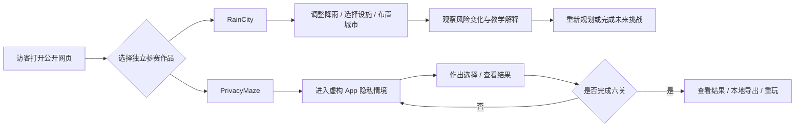

# 邪恶双子星 · 双项目参赛原型总体说明与设计基线

> **文档版本**：V0.1（第一版设想与设计，非最终产品需求）  
> **状态截止日期**：2026-11-17  
> **文档状态**：基于现有源代码审阅整理；供归档、后续选型、Qoder 开发交接  
> **团队名称**：邪恶双子星  
> **项目**：RainCity 雨城实验室 / PrivacyMaze 隐私迷宫  
> **开发状态**：两个独立、可本地打开的静态网页概念原型；尚不能认定已通过 Qoder 开发、公开部署或完成真实浏览器验收

## 1. 文档目的与依据

本文件记录两个项目在 **2026-11-17** 的首版产品设想、设计原则与源码现状，形成可以回溯的 **V0.1 设计基线**。目标是为后续 Qoder 开发提供明确起点，避免把构想当作已完成成果、把教学模拟夸大为实际工程能力。

**直接审阅的源材料**：

- `RainCity/index.html` 与 `RainCity/README.md`；
- `PrivacyMaze/index.html` 与 `PrivacyMaze/README.md`；
- 双项目原型包的顶层 `README.md`；
- 本次对话中的大赛截图及用户确立的参赛方案。

源码指纹（SHA-256）：

| 原型 | `index.html` SHA-256 |
|---|---|
| RainCity | `7b5c136f8b7aec778b4340c782db196264268d423755330b44a8be78a8520e5f` |
| PrivacyMaze | `61cce2ce1421d236ac8fc38061d51c5c14b725f10d7e39a820fefb7e7c1cbc97` |

这两个文件的指纹用于判断未来修改是否偏离当前版本。本文件是**说明与设计**，**不修改原有源代码**。后续要调整功能时，应更新文档版本并记录变更，不以本版覆盖新需求。

## 2. 背景、赛道与参赛约束

| 项目 | 中文名称 | 计划赛道 | 定位 | 建议优先级 |
|---|---|---|---|---|
| RainCity | 雨城实验室 | Hack4Good 技术向善 | 城市内涝与海绵城市的交互式科普实验 | 主力参赛作品 |
| PrivacyMaze | 隐私迷宫 | LifeHack 生活娱乐 | 数字隐私与暗黑交互设计的情境式选择游戏 | 第二独立作品 |

根据用户提供的当届赛事截图，当前已知参赛要求包括：使用 Qoder 开发并部署为公网可访问作品；发布对应作品介绍；允许同一团队提交不限份数，但每个团队只取最高分的一项现金奖；报名和作品发布截止显示为 **11 月 30 日 18:00**。**提交前仍应以官方实时规则和签署的授权协议为准**，不能以本文件替代官方要求。

本次采用 **两个独立仓库／项目、两份提交、分别评审** 的策略；不能因同时参赛而把两套内容混成一个站点或复用彼此的内部状态。

## 3. 共同设计原则

1. **真实可交互**：评委无需注册，在浏览器打开就能完成核心体验。
2. **三分钟理解价值**：首屏看懂问题，一分钟发生有效操作，三分钟体验到结果和解释。
3. **教育可解释**：RainCity 的计算透明、可复现；PrivacyMaze 的反馈具体、避免绝对化判定。
4. **易于迁移**：首版纯前端、无需云数据库和密钥；未来可部署在自己的静态托管服务上。
5. **隐私最小化**：不读取真实定位、通讯录、账户、财务数据；默认不接入外部分析 SDK、广告、模型 API。
6. **知识产权隔离**：不引用、不改造、不提交 EveryLedger / TripLedger 项目的生产源码、数据和核心业务设计。
7. **渐进扩展**：保证 V0.1 核心交互正确，再考虑视觉升级、更多关卡和玩法。
8. **用户掌控发布**：Qoder 内开发、预览和测试可以开展；正式公开发布由用户确认。

## 4. V0.1 已实现功能总览（依据代码）

### 4.1 RainCity

- 10 × 8＝80 格静态虚构城市，格子可点击放置设施；
- 降雨滑块：30–140 mm/h、步长 5，初始 80 mm/h；三个预设情景：45/80/130 mm/h；
- 设施：雨水花园（费用 3）、雨水口（费用 4）、抽排泵站（费用 7）；总预算 24；
- 可以建造、拆除、撤销一步、重置，以及一键载入预设示范规划；
- 即时计算 0–100 教学风险指数、风险 ≥65 的格子数、与同雨量“零设施”情景的平均风险差；
- 单页面响应式布局、说明文字和科学诚信免责声明。

**没有实现**：真实降雨径流计算、真实地形数据、地图底图、水流动画、任务关卡、存档、关卡评分、工程级防洪评估、服务器后端或公开部署。

### 4.2 PrivacyMaze

- 6 个虚构情境，每关 3 个选择：位置授权、默认勾选、通讯录邀请、诱导订阅、第三方共享、账号注销；
- 每关选择后给出反馈、教育提示，记录选择并累积分值；
- 进度条、积分仪表、六关汇总、三档结尾文案、本地 `.txt` 报告导出、重玩；
- 单页面响应式布局、虚构 App 信息卡、无需账户或后端。

**没有实现**：不同情境的高保真拟真交互、真正随选择变化的故事分支、关卡中途返回、跨刷新进度保存、法律合规审计、用户数据扫描或公开部署。

## 5. 高层用户体验与信息架构



**说明**：流程图中的“未来挑战”只表示后续设计方向，不是当前代码存在的功能。

## 6. 技术实现边界与后续架构方向

当前两份原型均为单文件 `index.html`，样式和脚本内嵌；不依赖构建工具、Node 后端、API Key 或数据库。它们可通过本地双击打开，原则上适合静态托管。是否能在特定平台持续托管、是否满足比赛合规要求，仍需实际部署和验证。

V0.2 可以在 Qoder 中拆分为：

```text
RainCity/ 或 PrivacyMaze/
├─ src/
│  ├─ app/                  # 页面入口与状态
│  ├─ components/           # UI 组件
│  ├─ domain/               # 纯计算模型 / 关卡规则
│  ├─ content/              # 文案和情境数据
│  └─ styles/               # 主题与响应式设计
├─ tests/                   # 单元 / 交互测试
├─ public/                  # 本地静态资源
└─ README.md / CHANGELOG.md
```

这只是**建议的后续架构**，目前并不存在上述目录。实现可以选择 Vite + TypeScript，也可以选择同等轻量可维护方案；不能为了“技术栈好看”而牺牲上线时间。

## 7. 联合质量与安全标准

| 项目 | V0.2 建议的最低验收标准 |
|---|---|
| 可访问性 | 公网 URL 无登录打开；键盘能够完成关键任务；文字与颜色信息不只靠颜色区分 |
| 可靠性 | 反复重置、极端输入和连续点击不出错；控制台无未处理错误 |
| 兼容性 | 桌面 Chromium + 手机浏览器实际操作；主流程不横向溢出 |
| 内容真实性 | RainCity 风险模型为科普示意；PrivacyMaze 不是法律或真实安全评分 |
| 数据与隐私 | 未经授权不引入网络请求、真实账号、位置、通讯录、分析统计或第三方追踪 |
| 变更可追溯 | 每个项目独立提交记录、变更日志、测试结果与部署记录 |
| 比赛证据 | 可证明通过 Qoder 参与实际开发、能够运行，保留本人可复核的测试证据 |

**当前验证状态**：已对源码和原 README 做静态审阅；本次没有完成真实浏览器端到端操作、移动端真机测试、Qoder Sites 公网测试或赛事合规审核。因此不能声称“参赛验收通过”。

## 8. 建议版本路线

| 阶段 | RainCity | PrivacyMaze | 交付定义 |
|---|---|---|---|
| **V0.1：概念原型** | 80 格沙盘 + 三设施 + 风险指数 | 六关选择 + 积分 + TXT 报告 | **已具备源码，待真实操作验收** |
| **V0.2：参赛增强** | 规划对比、2 组任务、可读动画、模型说明 | 更拟真的六种情境界面、选择后果、结局建议 | Qoder 实际开发，功能完成并通过测试 |
| **V0.3：候选发布** | 可访问性、性能、测试和展陈 | 同左；路径覆盖与报告修订 | 两个独立候选版、公开访问前用户确认 |
| **V1.0：正式参赛版** | 正式站点与参赛帖 | 正式站点与参赛帖 | 公网、报名、材料、可复核证据齐备 |

这里的 V0.2 / V0.3 / V1.0 是**建议版本规划**，不是既定已完成的版本。后续时间表可根据用户科研和旅行安排调整。

## 9. 待用户确认的关键设计决策

1. RainCity 主打“自由规划沙盘”，还是把“限预算通关”作为首屏核心玩法？建议先保留自由沙盘，增加两个可选挑战。
2. RainCity 是否仅使用虚拟地图与虚拟数值？建议首版坚持，不接入真实气象或地理数据。
3. PrivacyMaze 定位为教育互动作品还是带剧情角色的游戏？建议保持教育准确性，增强情境表现而非复杂故事树。
4. PrivacyMaze 是否允许本地存档？建议先不做持久保存；如增加，必须让用户能一键清除。
5. 两个项目是否以后开源？未决定；**比赛提交、开源与公开 Git 仓库是不同决策**，不能自动等同。
6. 统一视觉品牌是否采用“邪恶双子星”？可以在作品页脚轻量署名，但两个产品应有自己的独立视觉系统。

## 10. 核心风险与约束

- **时间风险**：双项目并行容易出现“两个都能展示，却都未达到参赛质量”的情况；优先保证 RainCity 可演示与科学声明正确。
- **模型风险**：RainCity 的数字不是实测积水深度、真实洪水概率或工程校验结果；对所有图表和文案做统一审查。
- **教育准确性风险**：PrivacyMaze 不应把“任何允许权限”一概判定为错误；每个选择需结合场景说明。
- **外部依赖风险**：不用免费 API 也能完成，优先离线运行与静态托管。
- **平台与授权风险**：Qoder 开发证据、Sites 公网地址、比赛授权条款，都需要在正式提交前单独核实。
- **知识产权风险**：两个作品与 EveryLedger / TripLedger 完全隔离；禁止把私有仓库作为 Qoder 自动上下文来源。

## 11. 进一步阅读

- `01_RainCity_产品说明与设计规范_v0.1.md`：完整的沙盘、模型、交互、测试与 V0.2 规划。
- `02_PrivacyMaze_产品说明与设计规范_v0.1.md`：完整的关卡、评分、交互、测试与 V0.2 规划。
- `03_开发交接与验收清单_v0.1.md`：开工顺序、禁止事项、Qoder 交接提示词、发布门槛。

---

**归档原则**：本版是“首版设想＋代码现状”的历史快照。未来任何功能、命名、设计或评分调整以新版本文档记录，保留 V0.1 原件作为追溯依据。
