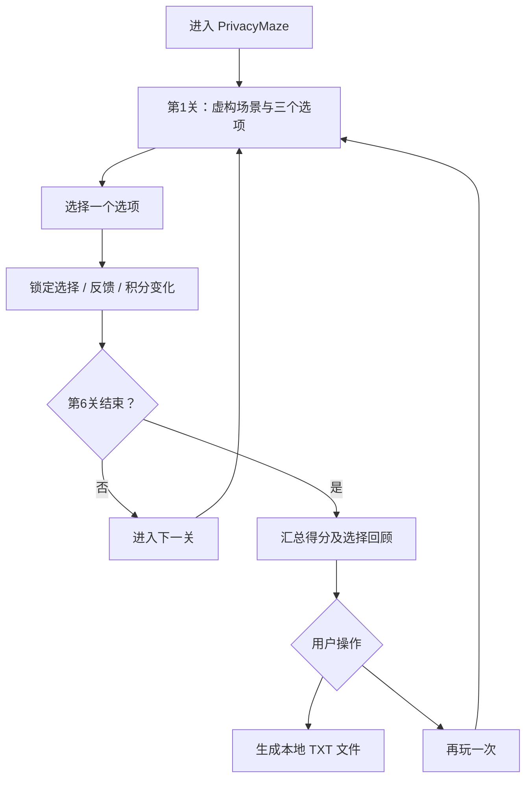

# PrivacyMaze · 隐私迷宫
## 产品说明与设计规范 V0.1

> **团队**：邪恶双子星  
> **计划赛道**：LifeHack 生活娱乐  
> **状态截止日期**：2026-11-17  
> **产品阶段**：可本地打开的独立前端概念原型（非正式参赛作品）  
> **文档属性**：基于实际代码提取的首版产品设想和设计范围，不代表法律合规认证

## 1. 产品概述

### 1.1 一句话介绍

**你以为你在做选择，还是别人替你做了选择？** PrivacyMaze 是一个关于数字隐私的交互式情境体验。玩家进入六个虚构 App 场景，面对过度授权、默认勾选、诱导订阅和注销障碍，作出选择，接收具体反馈，并得到一份仅在自己浏览器中生成的选择报告。

### 1.2 试图解决的问题

很多数字服务会通过默认选项、界面层级、文字显著性和流程复杂度影响用户的选择。对普通用户来说，“我点了同意”并不意味着理解了授权范围、数据流向或者退出机制。

PrivacyMaze 不把隐私安全讲成枯燥的法规背诵，而是将其转化为可体验、可讨论、可重玩的日常决策过程。

### 1.3 目标用户

- 普通手机与网页用户：认识常见授权和订阅陷阱；
- 青少年或数字素养课程的学习者：通过虚构案例讨论选择后果；
- 比赛评委与访问者：不注册，三分钟左右通关并理解核心主张。

产品**不是**真实账户安全检查器、隐私扫描器、法律咨询服务、合规审计工具或者恶意软件检测器。

### 1.4 产品主张

- **身临其境**：站在“注册、订阅、邀请朋友、注销”的真实生活节点思考；
- **尊重选择**：不仅告诉你“对错”，还解释为什么要关注用途、比例和退出权；
- **数据留在浏览器**：不要求输入个人信息，不连接外部账户；
- **学习而不是羞辱**：反馈注重提醒与成长，避免把某个用户简单贴上“没有隐私意识”的标签。

## 2. V0.1 已实现内容（经代码审阅）

| 编号 | 功能 | 当前行为 | 状态 |
|---|---|---|---|
| PM-01 | 六个主题关卡 | 位置、营销勾选、通讯录、订阅、数据共享、账户注销 | 已有 |
| PM-02 | 三选一交互 | 每关 3 个预设选项，点击一次即锁定 | 已有 |
| PM-03 | 即时解释 | 根据选择展示反馈文案及该关教学提示 | 已有 |
| PM-04 | 关卡顺序推进 | 第 1 关至第 6 关线性流程 | 已有 |
| PM-05 | 分数体系 | 每关得 0、5 或 20 分，满分 120 | 已有 |
| PM-06 | 进度与积分面板 | 关卡进度条、当前分数、积分比例 | 已有 |
| PM-07 | 结尾文案 | 按总分分成 3 档 | 已有 |
| PM-08 | 选择回顾 | 逐关记录选项、得分、教学提示 | 已有 |
| PM-09 | TXT 报告 | 浏览器生成、下载本地文字报告 | 已有 |
| PM-10 | 重新挑战 | 清空当前进程，从第 1 关重新开始 | 已有 |
| PM-11 | 隐私承诺与声明 | 页面说明不读取设备隐私信息、不提供真实安全评级 | 已有 |
| PM-12 | 响应式页面 | CSS 包含 800px 与 520px 断点 | 已编码，待真机验收 |

**明确未实现**：与真实操作系统权限弹窗联动、真实浏览器扩展权限管理、跨关动态剧情分支、六套差异化拟真 App 界面、关卡中途回退修改、刷新后继续、云端分数榜单、真实数据检测、外部追踪、服务器、Qoder Sites 公网部署。

## 3. 六关具体设计：当前版本

### 3.1 主题与教育目标

| 关卡 | 虚构场景 | 主要隐私／消费决策 | 当前最高分行为示例 |
|---|---|---|---|
| 01 权限与位置 | 城市生活 App 请求始终定位 | 授权范围是否与用途相称 | 使用时允许，或需要时再开启 |
| 02 默认勾选 | 注册表单预选营销信息 | 是否区分必要服务与可选营销 | 取消勾选或读清说明后决定 |
| 03 通讯录邀请 | 桌游小程序要求上传联系人 | 他人的联系人数据是否被过度采集 | 使用邀请链接，或不使用邀请 |
| 04 诱导订阅 | 图片编辑 App 强调七天免费试用 | 续费规则、取消入口是否清晰 | 先核实条款或继续免费版 |
| 05 数据共享 | 日程 App 询问广告共享同意 | 用途、接收方、撤回方式 | 核实合作方或拒绝非必要共享 |
| 06 账号注销 | 虚构服务提示卸载即可离开 | 卸载、停用与注销区别 | 查找注销入口或备份后申请注销 |

### 3.2 当前选项的实际分数

**关 1–4 与关 6**：三个选项的原始分值分别是 `0 / 20 / 20`。

**关 5 数据共享**：分别是 `5 / 20 / 20`。这里 5 分的设计反映：用户选择个性化广告本身不一定错误，但需要知情同意、了解共享范围及撤回方式。

**全局最高分**：`6 × 20 = 120`。

**结尾等级（当前代码阈值）**：

- `score ≥105`：“你的数字边界很清晰！”
- `70 ≤ score <105`：“你已经具备保护意识”
- `score <70`：“下次，试着多问一句‘为什么？’”

这些分数是**游戏化教育反馈**，不能作为玩家真实隐私风险、法律认知或实际安全水平的测量结果。

### 3.3 当前每关完整交互

1. 展示场景标题、背景说明、统一样式的虚构 App 信息卡。
2. 列出 3 个选择按钮（选项标题＋补充说明）。
3. 玩家选择后：锁定三个选项、选中项高亮、显示解释、更新积分面板。
4. 出现“进入下一关”按钮；第六关则显示“查看我的选择报告”。
5. 关卡之间**不改变后续题目内容**，仅累计得分与已做出的选择。

### 3.4 当前结尾报告

- 显示总分与三档结尾语；
- 按顺序显示 6 个情境选择与每关得分；
- 报告说明该结果只是虚构教育情境，不是隐私安全检测；
- 点击“保存我的选择报告”：使用 `Blob` 和浏览器生成 `PrivacyMaze_我的互动报告.txt`；
- 点击“再玩一次”：分数、回答记录、当前关卡都从头开始。

当前代码不使用 localStorage；**刷新页面会丢失进行中的挑战**。因此文档不能把“继续上次进度”写为已实现功能。

## 4. 产品流程与信息架构



页面现有结构：

```text
PrivacyMaze 单页
├─ 品牌与赛道标签
├─ 标题 / 宣言 / 当前关卡计数
├─ 六关总进度条
├─ 左：情境卡
│  ├─ 关卡标题与背景
│  ├─ 虚构 App 展示卡
│  ├─ 3 个行为选项
│  ├─ 教育反馈 / 下一关
│  └─ 完成后结果面板、下载与重玩
├─ 右：积分、保护理念、六关目录
└─ 教学与法律边界说明
```

## 5. 视觉与体验设计

### 5.1 V0.1 已有视觉风格

- 奶油白背景、淡紫色强调、浅绿色辅助，整体接近精致的教育/生活服务界面；
- 左边游戏主卡片、右边积分与提示卡片；
- 用浅紫色呈现主要选项与阶段进度；
- 反馈分为“较谨慎”和“值得再考虑”的不同背景；
- 统一的深色模拟 App 介绍卡用于六关，**还没有按关卡还原六种不同 UI**。

### 5.2 V0.2 建议的拟真交互（未实现）

以“不是一张问卷，而是六个微型 App 体验”为目标：

| 关卡 | 建议的拟真 UI | 交互亮点 |
|---|---|---|
| 01 | 系统样式的模拟位置权限弹窗 | 不使用真实设备权限，只模拟授权范围的区别 |
| 02 | 带默认勾选的注册表单 | 放大/高亮隐蔽同意项，让用户自己发现 |
| 03 | 邀请好友界面与联系人上传提示 | 对照“上传通讯录”和“分享链接”的差异 |
| 04 | 显眼免费试用按钮＋弱化条款 | 展现订阅按钮的视觉诱导与收费信息位置 |
| 05 | 多层信息共享选择页 | 解释接收方、目的与撤回通道 |
| 06 | 模拟注销流程与卸载提示 | 帮助理解注销和卸载不是同一件事 |

这些“模拟弹窗/表单”**不能真正调用浏览器位置、联系人、订阅付款或账号删除 API**，应持续标注为虚构训练场景。

### 5.3 体验语气

建议强调“你有选择权”“了解以后再决定”，不使用羞辱、恐吓或夸大性话术。高分代表游戏中选择与教学设定更一致，不代表低分用户不懂隐私保护。针对合法且自愿的共享选择，应解释隐私交换关系，不简单下“违法”结论。

## 6. 状态与数据设计：当前实现及下一版建议

### 6.1 当前代码实际状态

```js
// 概念摘录，变量与代码一致；不是独立运行示例
let index = 0;        // 当前关卡 0..5
let score = 0;        // 已累计积分
let answers = [];     // 已选项、得分、解释和提示
let answered = false; // 当前关卡是否已完成选择
```

`questions` 为 6 项静态数组；每项包含 `tag/title/desc/fakeTitle/fakeDesc/options/tip`；每个选项包含标题、辅助说明、分值和解释。

玩家选择后只在当前页面的 JS 内存中更新 `index`、`score`、`answers`，并直接更新 DOM。并未向服务器发送这些数据。下载是浏览器在本地构造 TXT 内容。

### 6.2 V0.2 可维护结构（设计草案）

```ts
// 设计草案，不是现有 TypeScript 文件
interface Choice {
  id: string;
  label: string;
  description: string;
  points: 0 | 5 | 20;
  feedback: string;
}
interface Scenario {
  id: string;
  title: string;
  description: string;
  teachingTip: string;
  choices: [Choice, Choice, Choice];
}
interface GameState {
  stageIndex: number;
  answers: {scenarioId: string; choiceId: string}[];
  status: 'choosing' | 'feedback' | 'finished';
}
```

建议将分数计算从 DOM 层移至纯函数：`scoreAnswer`、`scoreGame`、`getEnding`、`createLocalReport`；让 UI 根据状态渲染。需要确认是否允许修改已经提交的选择；当前 V0.1 不允许返回上一关。

### 6.3 数据保护边界

- 目前 **无账户、无位置/通讯录权限调用、无 HTTP API 请求、无 localStorage**；
- 学习报告在本地生成，保存位置由浏览器/用户决定；
- 正式版禁止引入第三方统计 SDK、广告像素或社交登录，除非另获授权并更新隐私说明；
- 若未来加入本地进度保存，应告知数据存于本机、用途、清除方法，不假称服务器端删除。

## 7. 功能优先级和非目标

**P0｜必须保留**：六关三选一、反馈、分数、结尾、逐关回顾、本地 TXT 下载、重玩、虚构场景声明、零账户和零真实隐私采集。

**P1｜优先增强**：六种差异化界面、关卡体验的自然过渡、结果成长建议、键盘／屏幕阅读器可操作性、完整路径测试。

**P2｜如有余力**：不同小结局、可选本地存档、可分享但不含个人信息的成绩卡、英文界面。

**明确非目标**：读取用户真实 App 权限、监控用户设备、批量扫描登录数据、自动取消真实订阅、代用户注销账户、真实法律合规认证、建立用户画像。

## 8. 测试与验收设计

**以下均为建议待执行测试，不是当前通过记录。**

| 编号 | 用例 | 预期结果 |
|---|---|---|
| PMT-01 | 首次打开 | 第一关出现，积分 0/120，进度 0/6 |
| PMT-02 | 在任一关选择一个选项 | 锁定一次，不重复加分，显示对应反馈 |
| PMT-03 | 第一关到第六关顺序通关 | 进度和关卡号正确递增 |
| PMT-04 | 六关全选 20 分 | 总分 120，最高等级结尾 |
| PMT-05 | 全选第一项 | 第五关得 5，其余 0，总分 5 |
| PMT-06 | 选择组合得到 70 左右 | 结尾等级按 ≥70、≥105 正确切换 |
| PMT-07 | 第六关结束后下载报告 | 文件可打开、中文无乱码、含 6 条选择和提示 |
| PMT-08 | 重玩 | 状态与积分清零，重新显示第一关 |
| PMT-09 | 连续点击同一选项/下一步 | 不重复答题、不错过关卡、不产生负分 |
| PMT-10 | 全部 3^6 = 729 条选择组合 | 每条都能完成，分数与规则一致（自动化测试） |
| PMT-11 | 强制刷新中途页面 | V0.1 返回初始关卡；如 V0.2 存档则需变更预期 |
| PMT-12 | 网络面板检查 | 不上传用户决策，不访问真实设备权限接口 |
| PMT-13 | 键盘、屏幕阅读器与手机端 | 能完成选择、看懂反馈、下载报告 |
| PMT-14 | 公网匿名访问与控制台 | 无需登录、主流程可用、无未处理错误 |

路径数 `3^6 = 729` 指仅六关的选项组合，不包括未来设计的多层剧情变化；如增加真正分支，测试矩阵也需随之扩展。

## 9. 已知问题和开发注意事项

1. **当前更像教育问答，不是丰富的互动游戏**：差异化拟真 App 界面是 V0.2 最重要的提升方向。
2. **没有真正的故事分支**：选择只影响反馈和总分，关卡内容及顺序固定；不能把它宣传为有 729 条“独立剧情线”。
3. **没有中途退出/返回机制**：当前刷新丢失进度，可能影响三分钟试玩的稳定性；改进取舍需用户确认。
4. **游戏分数依赖设计者价值判断**：避免把某类授权永远判成错误，应保留可解释反馈。
5. **暗黑模式与视觉诱导应有教学边界**：可模拟不良界面，但不能诱导玩家进行真实支付、交出真实资料或误认为被登录。
6. **当前代码未通过真实浏览器/移动设备的逐项验收**：内容、逻辑可读，不等于所有行为已实测通过。

## 10. Qoder 下一阶段开发任务书摘要

1. 从当前单页 V0.1 起步，先确保六关、评分和 TXT 导出正确，不得无关重写产品定位。
2. 在 Qoder 内实施独立开发，逐关打造拟真但不调用真实权限的虚构 App 页面；保持教学信息可读。
3. 保持数据不上传、无需登录，未经用户许可不引入第三方 SDK 或网络请求。
4. 把选择与评分逻辑拆成可测试模块；至少覆盖 729 条固定选项组合和重复点击等异常路径。
5. 完善键盘支持、读屏标注与移动端交互，制作正式参赛介绍图文。
6. Qoder Sites 先预览，经用户明确同意后公开发布；保留真实测试日志、变更记录和 Qoder 使用证明。
7. 不访问 EveryLedger / TripLedger 或其他私有资料、账户、生产系统。

## 11. 版本记录

| 版本 | 日期 | 内容 |
|---|---|---|
| V0.1 | 2026-11-17 | 整理六关真实内容、积分公式、页面状态、数据边界和拟真游戏增强方向；未修改代码 |

**V0.1 设计冻结说明**：本文件是第一版创意和设计历史记录。如需更换关卡、调整评分、增加存档或访问权限，应以独立的后续版本说明来承接，不追改历史版。
