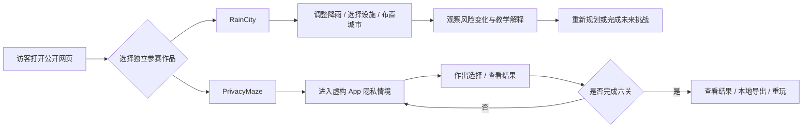
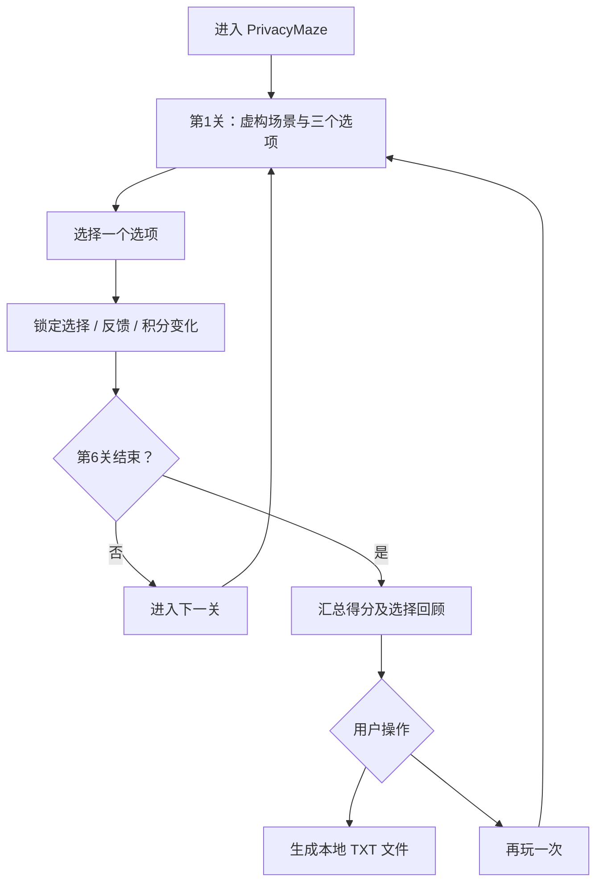

# 邪恶双子星 · RainCity 与 PrivacyMaze V0.1 综合说明与设计文档

**版本**：V0.1 ｜ **状态截止日期**：2026-11-17 ｜ **用途**：首版创意与设计永久存档、后续独立开发依据

> 这是根据保存的两份 HTML 原型与 README 进行的代码对照整理。文中“已实现”仅表示源码存在相应逻辑，不意味着已经真实浏览器验收、Qoder 开发或官方部署。未来功能均以“计划／拟增强”标注。本文件未修改原型源码。

## 阅读导航

1. 双项目总体定位、原型状态与统一原则
2. RainCity 的完整设计与教学模型说明
3. PrivacyMaze 的六关、积分与隐私边界说明
4. Qoder 开发交接任务及验收清单

---


---

<!-- 原始模块文档：00_双项目总体说明与设计基线_v0.1.md -->

# 邪恶双子星 · 双项目参赛原型总体说明与设计基线

> **文档版本**：V0.1（第一版设想与设计，非最终产品需求）  
> **状态截止日期**：2026-11-17  
> **文档状态**：基于现有源代码审阅整理；供归档、后续选型、Qoder 开发交接  
> **团队名称**：邪恶双子星  
> **项目**：RainCity 雨城实验室 / PrivacyMaze 隐私迷宫  
> **开发状态**：两个独立、可本地打开的静态网页概念原型；尚不能认定已通过 Qoder 开发、公开部署或完成真实浏览器验收

## 1. 文档目的与依据

本文件记录两个项目在 **2026-11-17** 的首版产品设想、设计原则与源码现状，形成可以回溯的 **V0.1 设计基线**。目标是为后续 Qoder 开发提供明确起点，避免把构想当作已完成成果、把教学模拟夸大为实际工程能力。

**直接审阅的源材料**：

- `RainCity/index.html` 与 `RainCity/README.md`；
- `PrivacyMaze/index.html` 与 `PrivacyMaze/README.md`；
- 双项目原型包的顶层 `README.md`；
- 本次对话中的大赛截图及用户确立的参赛方案。

源码指纹（SHA-256）：

| 原型 | `index.html` SHA-256 |
|---|---|
| RainCity | `7b5c136f8b7aec778b4340c782db196264268d423755330b44a8be78a8520e5f` |
| PrivacyMaze | `61cce2ce1421d236ac8fc38061d51c5c14b725f10d7e39a820fefb7e7c1cbc97` |

这两个文件的指纹用于判断未来修改是否偏离当前版本。本文件是**说明与设计**，**不修改原有源代码**。后续要调整功能时，应更新文档版本并记录变更，不以本版覆盖新需求。

## 2. 背景、赛道与参赛约束

| 项目 | 中文名称 | 计划赛道 | 定位 | 建议优先级 |
|---|---|---|---|---|
| RainCity | 雨城实验室 | Hack4Good 技术向善 | 城市内涝与海绵城市的交互式科普实验 | 主力参赛作品 |
| PrivacyMaze | 隐私迷宫 | LifeHack 生活娱乐 | 数字隐私与暗黑交互设计的情境式选择游戏 | 第二独立作品 |

根据用户提供的当届赛事截图，当前已知参赛要求包括：使用 Qoder 开发并部署为公网可访问作品；发布对应作品介绍；允许同一团队提交不限份数，但每个团队只取最高分的一项现金奖；报名和作品发布截止显示为 **11 月 30 日 18:00**。**提交前仍应以官方实时规则和签署的授权协议为准**，不能以本文件替代官方要求。

本次采用 **两个独立仓库／项目、两份提交、分别评审** 的策略；不能因同时参赛而把两套内容混成一个站点或复用彼此的内部状态。

## 3. 共同设计原则

1. **真实可交互**：评委无需注册，在浏览器打开就能完成核心体验。
2. **三分钟理解价值**：首屏看懂问题，一分钟发生有效操作，三分钟体验到结果和解释。
3. **教育可解释**：RainCity 的计算透明、可复现；PrivacyMaze 的反馈具体、避免绝对化判定。
4. **易于迁移**：首版纯前端、无需云数据库和密钥；未来可部署在自己的静态托管服务上。
5. **隐私最小化**：不读取真实定位、通讯录、账户、财务数据；默认不接入外部分析 SDK、广告、模型 API。
6. **知识产权隔离**：不引用、不改造、不提交 EveryLedger / TripLedger 项目的生产源码、数据和核心业务设计。
7. **渐进扩展**：保证 V0.1 核心交互正确，再考虑视觉升级、更多关卡和玩法。
8. **用户掌控发布**：Qoder 内开发、预览和测试可以开展；正式公开发布由用户确认。

## 4. V0.1 已实现功能总览（依据代码）

### 4.1 RainCity

- 10 × 8＝80 格静态虚构城市，格子可点击放置设施；
- 降雨滑块：30–140 mm/h、步长 5，初始 80 mm/h；三个预设情景：45/80/130 mm/h；
- 设施：雨水花园（费用 3）、雨水口（费用 4）、抽排泵站（费用 7）；总预算 24；
- 可以建造、拆除、撤销一步、重置，以及一键载入预设示范规划；
- 即时计算 0–100 教学风险指数、风险 ≥65 的格子数、与同雨量“零设施”情景的平均风险差；
- 单页面响应式布局、说明文字和科学诚信免责声明。

**没有实现**：真实降雨径流计算、真实地形数据、地图底图、水流动画、任务关卡、存档、关卡评分、工程级防洪评估、服务器后端或公开部署。

### 4.2 PrivacyMaze

- 6 个虚构情境，每关 3 个选择：位置授权、默认勾选、通讯录邀请、诱导订阅、第三方共享、账号注销；
- 每关选择后给出反馈、教育提示，记录选择并累积分值；
- 进度条、积分仪表、六关汇总、三档结尾文案、本地 `.txt` 报告导出、重玩；
- 单页面响应式布局、虚构 App 信息卡、无需账户或后端。

**没有实现**：不同情境的高保真拟真交互、真正随选择变化的故事分支、关卡中途返回、跨刷新进度保存、法律合规审计、用户数据扫描或公开部署。

## 5. 高层用户体验与信息架构



**说明**：流程图中的“未来挑战”只表示后续设计方向，不是当前代码存在的功能。

## 6. 技术实现边界与后续架构方向

当前两份原型均为单文件 `index.html`，样式和脚本内嵌；不依赖构建工具、Node 后端、API Key 或数据库。它们可通过本地双击打开，原则上适合静态托管。是否能在特定平台持续托管、是否满足比赛合规要求，仍需实际部署和验证。

V0.2 可以在 Qoder 中拆分为：

```text
RainCity/ 或 PrivacyMaze/
├─ src/
│  ├─ app/                  # 页面入口与状态
│  ├─ components/           # UI 组件
│  ├─ domain/               # 纯计算模型 / 关卡规则
│  ├─ content/              # 文案和情境数据
│  └─ styles/               # 主题与响应式设计
├─ tests/                   # 单元 / 交互测试
├─ public/                  # 本地静态资源
└─ README.md / CHANGELOG.md
```

这只是**建议的后续架构**，目前并不存在上述目录。实现可以选择 Vite + TypeScript，也可以选择同等轻量可维护方案；不能为了“技术栈好看”而牺牲上线时间。

## 7. 联合质量与安全标准

| 项目 | V0.2 建议的最低验收标准 |
|---|---|
| 可访问性 | 公网 URL 无登录打开；键盘能够完成关键任务；文字与颜色信息不只靠颜色区分 |
| 可靠性 | 反复重置、极端输入和连续点击不出错；控制台无未处理错误 |
| 兼容性 | 桌面 Chromium + 手机浏览器实际操作；主流程不横向溢出 |
| 内容真实性 | RainCity 风险模型为科普示意；PrivacyMaze 不是法律或真实安全评分 |
| 数据与隐私 | 未经授权不引入网络请求、真实账号、位置、通讯录、分析统计或第三方追踪 |
| 变更可追溯 | 每个项目独立提交记录、变更日志、测试结果与部署记录 |
| 比赛证据 | 可证明通过 Qoder 参与实际开发、能够运行，保留本人可复核的测试证据 |

**当前验证状态**：已对源码和原 README 做静态审阅；本次没有完成真实浏览器端到端操作、移动端真机测试、Qoder Sites 公网测试或赛事合规审核。因此不能声称“参赛验收通过”。

## 8. 建议版本路线

| 阶段 | RainCity | PrivacyMaze | 交付定义 |
|---|---|---|---|
| **V0.1：概念原型** | 80 格沙盘 + 三设施 + 风险指数 | 六关选择 + 积分 + TXT 报告 | **已具备源码，待真实操作验收** |
| **V0.2：参赛增强** | 规划对比、2 组任务、可读动画、模型说明 | 更拟真的六种情境界面、选择后果、结局建议 | Qoder 实际开发，功能完成并通过测试 |
| **V0.3：候选发布** | 可访问性、性能、测试和展陈 | 同左；路径覆盖与报告修订 | 两个独立候选版、公开访问前用户确认 |
| **V1.0：正式参赛版** | 正式站点与参赛帖 | 正式站点与参赛帖 | 公网、报名、材料、可复核证据齐备 |

这里的 V0.2 / V0.3 / V1.0 是**建议版本规划**，不是既定已完成的版本。后续时间表可根据用户科研和旅行安排调整。

## 9. 待用户确认的关键设计决策

1. RainCity 主打“自由规划沙盘”，还是把“限预算通关”作为首屏核心玩法？建议先保留自由沙盘，增加两个可选挑战。
2. RainCity 是否仅使用虚拟地图与虚拟数值？建议首版坚持，不接入真实气象或地理数据。
3. PrivacyMaze 定位为教育互动作品还是带剧情角色的游戏？建议保持教育准确性，增强情境表现而非复杂故事树。
4. PrivacyMaze 是否允许本地存档？建议先不做持久保存；如增加，必须让用户能一键清除。
5. 两个项目是否以后开源？未决定；**比赛提交、开源与公开 Git 仓库是不同决策**，不能自动等同。
6. 统一视觉品牌是否采用“邪恶双子星”？可以在作品页脚轻量署名，但两个产品应有自己的独立视觉系统。

## 10. 核心风险与约束

- **时间风险**：双项目并行容易出现“两个都能展示，却都未达到参赛质量”的情况；优先保证 RainCity 可演示与科学声明正确。
- **模型风险**：RainCity 的数字不是实测积水深度、真实洪水概率或工程校验结果；对所有图表和文案做统一审查。
- **教育准确性风险**：PrivacyMaze 不应把“任何允许权限”一概判定为错误；每个选择需结合场景说明。
- **外部依赖风险**：不用免费 API 也能完成，优先离线运行与静态托管。
- **平台与授权风险**：Qoder 开发证据、Sites 公网地址、比赛授权条款，都需要在正式提交前单独核实。
- **知识产权风险**：两个作品与 EveryLedger / TripLedger 完全隔离；禁止把私有仓库作为 Qoder 自动上下文来源。

## 11. 进一步阅读

- `01_RainCity_产品说明与设计规范_v0.1.md`：完整的沙盘、模型、交互、测试与 V0.2 规划。
- `02_PrivacyMaze_产品说明与设计规范_v0.1.md`：完整的关卡、评分、交互、测试与 V0.2 规划。
- `03_开发交接与验收清单_v0.1.md`：开工顺序、禁止事项、Qoder 交接提示词、发布门槛。

---

**归档原则**：本版是“首版设想＋代码现状”的历史快照。未来任何功能、命名、设计或评分调整以新版本文档记录，保留 V0.1 原件作为追溯依据。


---

<!-- 原始模块文档：01_RainCity_产品说明与设计规范_v0.1.md -->

# RainCity · 雨城实验室
## 产品说明与设计规范 V0.1

> **团队**：邪恶双子星  
> **计划赛道**：Hack4Good 技术向善  
> **状态截止日期**：2026-11-17  
> **产品阶段**：可本地打开的独立前端概念原型（非正式参赛作品）  
> **文档属性**：当前实现事实＋明确标注的下一版设想，不是对模型准确性的认证

## 1. 产品概述

### 1.1 一句话介绍

**暴雨来了，你的城市准备好了吗？** RainCity 是一款可交互的城市内涝与海绵城市科普体验：用户在 80 格虚拟城市中分配有限预算，放置雨水花园、雨水口与抽排泵站，并切换降雨强度，即时观察 **示意风险指数** 的变化。

### 1.2 背景问题

日常公众常听到“海绵城市”“城市内涝”“雨水花园”“排水能力”等概念，却难以直观理解地形、地表下渗、降雨强度与不同设施的作用范围；传统科普文字和静态图缺少探索反馈。

RainCity 试图以**可控实验**传达三件事：相同降雨下不同地块的风险不同；设施会产生局部和邻域效应；资源有限时规划位置比单纯堆数量更有讨论价值。

### 1.3 目标用户与使用方式（设计设想）

- 普通公众与中学生：三分钟认识城市雨洪治理的基本因素；
- 地理、环境与水文相关学生：课堂演示、讨论“模型假设”和“规划权衡”；
- 比赛评委：无需安装、注册或查看代码，直接尝试实验并获得可解释结果。

不面向工程设计、专业防洪预警、灾害应急指挥或任何影响真实生命财产安全的决策。

### 1.4 价值主张

- **看得见**：80 格虚拟城市用着色提示不同相对风险；
- **玩得动**：变更雨量、放置设施、拆除和撤销都有实时反馈；
- **说得清**：数字随同一套明确规则变化，便于对比；
- **有边界**：清楚标注教学性质，避免伪装为专业洪水预测。

## 2. V0.1 已实现内容（经代码审阅）

| 编号 | 功能 | 代码中的具体行为 | 状态 |
|---|---|---|---|
| RC-01 | 城市地图 | 10 列 × 8 行共 80 格，虚拟住宅、道路、办公和学校元素 | 已有 |
| RC-02 | 地块交互 | 选择设施后点击格子，单格最多一项设施 | 已有 |
| RC-03 | 雨量控制 | 30–140 mm/h，步进 5，初始 80 | 已有 |
| RC-04 | 快捷情景 | 小雨 45、强降雨 80、极端降雨 130 mm/h | 已有 |
| RC-05 | 三类设施 | 雨水花园 3、雨水口 4、抽排泵站 7 预算点 | 已有 |
| RC-06 | 预算限制 | 总预算 24，超限拒绝新建设 | 已有 |
| RC-07 | 编辑操作 | 建造、拆除退还费用、撤销上一步、重置 | 已有 |
| RC-08 | 示例规划 | 一键放置 5 项示范设施，总成本 21 | 已有 |
| RC-09 | 统计指标 | 平均风险、高风险地块数、相对零设施方案的改善 | 已有 |
| RC-10 | 动态讲解 | 根据当前平均风险和高风险街区数更新解释 | 已有 |
| RC-11 | 科学免责声明 | 明示虚构地形、教学指数、不能用于真实工程 | 已有 |
| RC-12 | 桌面/移动布局 | CSS 包含 850px 与 530px 响应式断点 | 已编码，待真机验收 |

**明确未实现**：积水深度、水动力学仿真、真实地理数据、真实雨洪预报、粒子级雨水动画、任务目标／通关评分、用户账户、持久化存档、多人协作、后端、Qoder Sites 公网部署。

## 3. 核心玩法与用户旅程

### 3.1 核心循环

1. **观察**：打开页面查看默认 80 mm/h 场景和现状风险；
2. **施加扰动**：切换 45/80/130 mm/h 或拖动雨量滑块；
3. **采取措施**：选择雨水花园／雨水口／抽排泵站，在地图某格放置；
4. **得到反馈**：风险颜色、平均风险、高风险地块数量及改善点数即时更新；
5. **迭代**：拆除、撤销、重置或加载示例方案，比较不同配置。

### 3.2 演示路径（推荐，不代表验收通过）

“打开页面 → 点击『极端降雨』→ 观察中部低洼街区 → 选择雨水口 → 点击地图地块 → 阅读风险指标变化 → 尝试泵站 → 点击『试一试规划方案』→ 改变雨量进行对比”。

### 3.3 页面信息架构

```text
RainCity 单页
├─ 顶栏：品牌与赛道标签
├─ 首屏：问题引导、产品一句话、无登录标签
├─ 主内容
│  ├─ 城市沙盘：80 格 / 风险图例 / 指标卡
│  └─ 规划台：设施选择 / 预算 / 雨量 / 情景 / 操作按钮 / 反馈解释
├─ 方法说明：模型计算原则
└─ 科学诚信：教学性质及应用边界
```

### 3.4 核心交互规则（当前）

- 初始选中“雨水花园”。
- 点击已建设地块时不自动覆盖，需先选“拆除设施”；避免无意覆盖。
- 建造费用不得超过可用预算；拆除返还该设施的成本。
- “撤销一步”回滚最近一次建造／拆除／重置／加载示例对设施布局的变更；当前代码**不撤销降雨滑块变化**。
- “重置城市”清空设施布局，**不自动把降雨恢复到 80 mm/h**。
- “试一试规划方案”覆盖当前设施布局，载入固定的五项设施；可再撤销回上一个布局。
- 当前地图允许在任何格子上替换地块类型为设施，尚无“道路不可建雨水花园”等规则；这是后续应处理的模型可解释性问题。

## 4. 教学风险模型设计：当前代码真实逻辑

> **重要**：以下是对 V0.1 已有代码的整理，并不是经实测、标定或验证的城市雨洪模型。所有参数均为虚构教学参数。

### 4.1 地图与输入

- 地图：宽 `W=10`、高 `H=8`、80 个单元格，坐标 `x=0..9`、`y=0..7`。
- 降雨变量 `R`：`30..140`，步长 5，单位显示为 `mm/h`。
- 地块初始类型按坐标的固定规则生成 `home`、`road`、`office`、`school`。
- 已建设设施按 `{格子索引: 设施类型}` 的映射保存。单格至多一项设施。

### 4.2 地块下渗与地形项

当前代码设定地类系数 `c(type)`：

| 地类 | 系数 |
|---|---:|
| 住宅 home | 1.02 |
| 道路 road | 1.22 |
| 办公 office | 1.15 |
| 学校 school | 1.03 |
| 雨水花园 park | 0.38 |
| 雨水口 drain | 1.02 |
| 抽排泵站 pump | 1.02 |

地形项（模拟低洼条件）为：

```text
terrain(x,y) = max(0, 20 - 3 × abs(x - 4.5))
             + (y > 4 ? 12 : 0)
             + (y == 6 ? 6 : 0)
```

基础值 `v = R × 0.66 × c(type) + terrain(x,y) - 15`。

### 4.3 设施邻域作用

以**曼哈顿距离** `d = abs(x1-x2) + abs(y1-y2)` 计算邻域；同时存在多个设施时，当前代码直接累加各设施作用。

| 设施 | d=0 | d=1 | d=2 | d=3 | 超出作用距离 |
|---|---:|---:|---:|---:|---:|
| 雨水花园 | -22 | -7 | -3 | 0 | 0 |
| 雨水口 | -20 | -13 | -4 | 0 | 0 |
| 抽排泵站 | -31 | -23 | -13 | -6 | 0 |

最终 `risk(i) = round(clamp(v - 所有设施影响之和, 0, 100))`。

**注意**：建设雨水花园还会改变当前地块的地类系数，因而具有“替换当前地类系数＋邻域作用”的双重影响。这是现有公式的行为，正式版需要解释与审查，不应直接解读为真实措施效率。

### 4.4 指标定义

| 指标 | 现有定义 | 解释边界 |
|---|---|---|
| 平均内涝风险 | 80 格风险值的平均数，四舍五入 | 仅是教学相对指数，不是概率 |
| 高风险街区 | 风险值 `≥65` 的地块数量 | 65 是人为教学阈值，不是预警标准 |
| 相对无措施改善 | 相同雨量下零设施方案平均值减当前平均值，最小显示 0 | 只在同一简化模型内有对照意义 |
| 颜色深浅 | 风险升高，水蓝叠色变明显 | 不代表积水深度或洪灾等级 |

### 4.5 科学诚信的页面强制文案原则

必须持续向用户明确说明：

> 本项目使用虚拟地形、虚拟成本与启发式教学模型。显示的风险指数并不代表实际积水深度、洪水发生概率或真实安全状况。结果不能用于工程设计、预警和应急决策。

如未来引入真实地形、实时降雨或复杂模型，需另行记录数据来源、单位体系、计算条件、验证方法与适用边界。

## 5. 视觉与交互设计

### 5.1 已有视觉基调

- 深蓝／青绿色科技感：整体为夜间城市与雨水主题。
- 左侧大面积地图、右侧规划台，底部显示模型与科学声明。
- 风险通过浅蓝到深蓝色层叠展示；设施通过图形字符/符号辨识。
- 主要行动按钮强调亮青色；规划工具高亮当前选中状态。

### 5.2 V0.2 拟优化（未实现）

1. **规划前后比较**：同雨量下两张沙盘或滑动对比，明确“改造前/后”及变化原因。
2. **关卡挑战**：拟设“预算有限保住街区”“极端降雨优化”等 2 个可选任务；通关阈值需测试后确定，不应提前填入未经验证的分数。
3. **视觉动效**：可添加轻量的雨滴、积水示意动效，但必须注明是可视化符号而非真实水流模拟。
4. **布局适配**：小屏幕保持地图格子可触控，指标不会挤出容器；可在窄屏折叠规划工具。
5. **无障碍**：地块按钮可以键盘聚焦；增加地图行列和当前工具的朗读反馈；防止单纯依赖颜色表达风险。
6. **过程说明**：增加“为什么这里风险更高”“设施如何影响邻域”等可展开教学说明。

## 6. 功能优先级与非目标

**P0｜参赛版必须**：可交互沙盘、雨量与三设施、24 预算限制、准确计算当前教学指标、重置／撤销、科学声明、基础响应式、公开演示。

**P1｜优先增强**：同条件前后对照、两组挑战、统一动画、可解释教学卡、键盘可用、自动化测试。

**P2｜时间允许**：关卡成绩分享图片、不同虚拟城市主题、音效、个人成就；这些不得影响核心交付。

**明确非目标（至少本届比赛）**：真实洪涝预测、实用防灾指南决策支持、政府/工程系统接入、付费地图 API、复杂 GIS 后端、用户注册和云端同步。

## 7. 后续架构与数据结构建议（设计草案）

建议将纯计算函数与界面分离，便于测试和将来迁移：

```ts
// 设计草案，不是现有源码中的 TypeScript 接口
 type FacilityType = 'park' | 'drain' | 'pump';
 type RainScenario = 45 | 80 | 130;
 interface CityState {
   width: 10;
   height: 8;
   rainMmPerHour: number;
   selectedTool: FacilityType | 'remove';
   facilities: Record<number, FacilityType>;
   undoStack: Record<number, FacilityType>[];
 }
 interface RiskMetrics {
   perTile: number[];
   average: number;
   highRiskCount: number;
   improvementPoints: number;
 }
```

领域模块建议：`baseTileType`、`terrainAt`、`riskAt`、`calculateMetrics`、`validateBuild`、`applyAction`。界面层不应自行复制核心公式。

## 8. 验收与测试设计

以下为**待执行测试**，不代表已经通过：

| 编号 | 用例 | 预期结果 |
|---|---|---|
| RA-01 | 首次打开 | 显示 80 个地块、80 mm/h、预算 24/24 |
| RA-02 | 选择雨水花园，建 1 个 | 预算变 21；地块显示设施；指标可更新 |
| RA-03 | 放置雨水口与泵站 | 分别扣除 4 和 7 点预算 |
| RA-04 | 已有设施重复放置 | 不覆盖；不重复扣费 |
| RA-05 | 超过预算尝试建设 | 操作拒绝；设施与预算不变 |
| RA-06 | 拆除已有设施 | 恢复预算与空闲地块状态 |
| RA-07 | 撤销、重置、撤销重置 | 布局状态按预期回滚 |
| RA-08 | 雨量 30/140 边界切换 | 指标始终 0–100；页面无异常 |
| RA-09 | 同一布局同一雨量重复计算 | 结果确定且一致 |
| RA-10 | 加载示例方案 | 五项设施，总成本 21，剩余 3 |
| RA-11 | 雨量改变后再撤销设施操作 | 只恢复设施布局，雨量保持当前值（V0.1 行为） |
| RA-12 | 键盘与手机端完成核心流程 | 操作可达、不溢出、文本可辨 |
| RA-13 | 检查所有宣传和结果文案 | 无“预测真实洪灾”“模拟积水深度”等虚假表述 |
| RA-14 | 公网匿名访问 | 可在 Qoder Sites 无登录完整运行、控制台无严重错误 |

建议 V0.2 将计算测试与 UI 回归测试分开；自动检查预算守恒、风险上下界、设施位置合法性和撤销历史。需要对任何修改后的新公式进行快照或性质测试，不能只看视觉效果。

## 9. 已知限制与开发风险

- **计算是启发式教学模型**：缺乏质量守恒、排水管网、汇流过程、地形测量与模型校准。
- **静态格子替代真实地形**：不能被误写为“城市数字孪生”。
- **指标容易被误读**：`0–100` 不是概率，`≥65` 不是行政预警等级。
- **设施可建在所有地块**：现有实现不会根据原始地类禁止建设，需要审视是否引入限制或明确“抽象地块”设定。
- **只有撤销一步功能的历史栈**：实际可连续撤销多步；但刷新会清空，不支持重做，不恢复雨量历史。
- **无真实交互验收证据**：代码和 README 可审阅，不等于已经逐项人工或自动测试通过。

## 10. Qoder 下一阶段开发任务书摘要

1. 保留 10×8 沙盘、三种设施、预算、三档雨量和教育声明；先审查实现正确性。
2. 拆分计算与 UI，写单元测试，建立独立代码仓库和变更记录。
3. 先完成“改造前/后”对比，再加两个可选挑战，**难度阈值经过实际玩法测试后确定**。
4. 提升视觉表现、手机布局、键盘辅助和解释性反馈；不引入无必要的外部依赖。
5. 使用 Qoder 实际开发并形成可核查开发记录；先部署预览，未经用户确认不正式公开发布。
6. 做真实浏览器/手机端验收，提交测试结果、未解决缺陷、版本号与公开站点说明。
7. 禁止读取其他私有仓库，尤其 EveryLedger / TripLedger；禁止接入真实设备或工程系统。

## 11. 版本记录

| 版本 | 日期 | 内容 |
|---|---|---|
| V0.1 | 2026-11-17 | 按既有单文件源码整理产品设想、实际功能、模型规则、交互与后续设计；未修改代码 |

**V0.1 设计冻结说明**：本文件用于保留第一版想法。涉及算法替换、阈值修改、新关卡、数据读取或发布权限的决定，均应在后续版本单独记录。


---

<!-- 原始模块文档：02_PrivacyMaze_产品说明与设计规范_v0.1.md -->

# PrivacyMaze · 隐私迷宫
## 产品说明与设计规范 V0.1

> **团队**：邪恶双子星  
> **计划赛道**：LifeHack 生活娱乐  
> **状态截止日期**：2026-11-17  
> **产品阶段**：可本地打开的独立前端概念原型（非正式参赛作品）  
> **文档属性**：基于实际代码提取的首版产品设想和设计范围，不代表法律合规认证

## 1. 产品概述

### 1.1 一句话介绍

**你以为你在做选择，还是别人替你做了选择？** PrivacyMaze 是一个关于数字隐私的交互式情境体验。玩家进入六个虚构 App 场景，面对过度授权、默认勾选、诱导订阅和注销障碍，作出选择，接收具体反馈，并得到一份仅在自己浏览器中生成的选择报告。

### 1.2 试图解决的问题

很多数字服务会通过默认选项、界面层级、文字显著性和流程复杂度影响用户的选择。对普通用户来说，“我点了同意”并不意味着理解了授权范围、数据流向或者退出机制。

PrivacyMaze 不把隐私安全讲成枯燥的法规背诵，而是将其转化为可体验、可讨论、可重玩的日常决策过程。

### 1.3 目标用户

- 普通手机与网页用户：认识常见授权和订阅陷阱；
- 青少年或数字素养课程的学习者：通过虚构案例讨论选择后果；
- 比赛评委与访问者：不注册，三分钟左右通关并理解核心主张。

产品**不是**真实账户安全检查器、隐私扫描器、法律咨询服务、合规审计工具或者恶意软件检测器。

### 1.4 产品主张

- **身临其境**：站在“注册、订阅、邀请朋友、注销”的真实生活节点思考；
- **尊重选择**：不仅告诉你“对错”，还解释为什么要关注用途、比例和退出权；
- **数据留在浏览器**：不要求输入个人信息，不连接外部账户；
- **学习而不是羞辱**：反馈注重提醒与成长，避免把某个用户简单贴上“没有隐私意识”的标签。

## 2. V0.1 已实现内容（经代码审阅）

| 编号 | 功能 | 当前行为 | 状态 |
|---|---|---|---|
| PM-01 | 六个主题关卡 | 位置、营销勾选、通讯录、订阅、数据共享、账户注销 | 已有 |
| PM-02 | 三选一交互 | 每关 3 个预设选项，点击一次即锁定 | 已有 |
| PM-03 | 即时解释 | 根据选择展示反馈文案及该关教学提示 | 已有 |
| PM-04 | 关卡顺序推进 | 第 1 关至第 6 关线性流程 | 已有 |
| PM-05 | 分数体系 | 每关得 0、5 或 20 分，满分 120 | 已有 |
| PM-06 | 进度与积分面板 | 关卡进度条、当前分数、积分比例 | 已有 |
| PM-07 | 结尾文案 | 按总分分成 3 档 | 已有 |
| PM-08 | 选择回顾 | 逐关记录选项、得分、教学提示 | 已有 |
| PM-09 | TXT 报告 | 浏览器生成、下载本地文字报告 | 已有 |
| PM-10 | 重新挑战 | 清空当前进程，从第 1 关重新开始 | 已有 |
| PM-11 | 隐私承诺与声明 | 页面说明不读取设备隐私信息、不提供真实安全评级 | 已有 |
| PM-12 | 响应式页面 | CSS 包含 800px 与 520px 断点 | 已编码，待真机验收 |

**明确未实现**：与真实操作系统权限弹窗联动、真实浏览器扩展权限管理、跨关动态剧情分支、六套差异化拟真 App 界面、关卡中途回退修改、刷新后继续、云端分数榜单、真实数据检测、外部追踪、服务器、Qoder Sites 公网部署。

## 3. 六关具体设计：当前版本

### 3.1 主题与教育目标

| 关卡 | 虚构场景 | 主要隐私／消费决策 | 当前最高分行为示例 |
|---|---|---|---|
| 01 权限与位置 | 城市生活 App 请求始终定位 | 授权范围是否与用途相称 | 使用时允许，或需要时再开启 |
| 02 默认勾选 | 注册表单预选营销信息 | 是否区分必要服务与可选营销 | 取消勾选或读清说明后决定 |
| 03 通讯录邀请 | 桌游小程序要求上传联系人 | 他人的联系人数据是否被过度采集 | 使用邀请链接，或不使用邀请 |
| 04 诱导订阅 | 图片编辑 App 强调七天免费试用 | 续费规则、取消入口是否清晰 | 先核实条款或继续免费版 |
| 05 数据共享 | 日程 App 询问广告共享同意 | 用途、接收方、撤回方式 | 核实合作方或拒绝非必要共享 |
| 06 账号注销 | 虚构服务提示卸载即可离开 | 卸载、停用与注销区别 | 查找注销入口或备份后申请注销 |

### 3.2 当前选项的实际分数

**关 1–4 与关 6**：三个选项的原始分值分别是 `0 / 20 / 20`。

**关 5 数据共享**：分别是 `5 / 20 / 20`。这里 5 分的设计反映：用户选择个性化广告本身不一定错误，但需要知情同意、了解共享范围及撤回方式。

**全局最高分**：`6 × 20 = 120`。

**结尾等级（当前代码阈值）**：

- `score ≥105`：“你的数字边界很清晰！”
- `70 ≤ score <105`：“你已经具备保护意识”
- `score <70`：“下次，试着多问一句‘为什么？’”

这些分数是**游戏化教育反馈**，不能作为玩家真实隐私风险、法律认知或实际安全水平的测量结果。

### 3.3 当前每关完整交互

1. 展示场景标题、背景说明、统一样式的虚构 App 信息卡。
2. 列出 3 个选择按钮（选项标题＋补充说明）。
3. 玩家选择后：锁定三个选项、选中项高亮、显示解释、更新积分面板。
4. 出现“进入下一关”按钮；第六关则显示“查看我的选择报告”。
5. 关卡之间**不改变后续题目内容**，仅累计得分与已做出的选择。

### 3.4 当前结尾报告

- 显示总分与三档结尾语；
- 按顺序显示 6 个情境选择与每关得分；
- 报告说明该结果只是虚构教育情境，不是隐私安全检测；
- 点击“保存我的选择报告”：使用 `Blob` 和浏览器生成 `PrivacyMaze_我的互动报告.txt`；
- 点击“再玩一次”：分数、回答记录、当前关卡都从头开始。

当前代码不使用 localStorage；**刷新页面会丢失进行中的挑战**。因此文档不能把“继续上次进度”写为已实现功能。

## 4. 产品流程与信息架构



页面现有结构：

```text
PrivacyMaze 单页
├─ 品牌与赛道标签
├─ 标题 / 宣言 / 当前关卡计数
├─ 六关总进度条
├─ 左：情境卡
│  ├─ 关卡标题与背景
│  ├─ 虚构 App 展示卡
│  ├─ 3 个行为选项
│  ├─ 教育反馈 / 下一关
│  └─ 完成后结果面板、下载与重玩
├─ 右：积分、保护理念、六关目录
└─ 教学与法律边界说明
```

## 5. 视觉与体验设计

### 5.1 V0.1 已有视觉风格

- 奶油白背景、淡紫色强调、浅绿色辅助，整体接近精致的教育/生活服务界面；
- 左边游戏主卡片、右边积分与提示卡片；
- 用浅紫色呈现主要选项与阶段进度；
- 反馈分为“较谨慎”和“值得再考虑”的不同背景；
- 统一的深色模拟 App 介绍卡用于六关，**还没有按关卡还原六种不同 UI**。

### 5.2 V0.2 建议的拟真交互（未实现）

以“不是一张问卷，而是六个微型 App 体验”为目标：

| 关卡 | 建议的拟真 UI | 交互亮点 |
|---|---|---|
| 01 | 系统样式的模拟位置权限弹窗 | 不使用真实设备权限，只模拟授权范围的区别 |
| 02 | 带默认勾选的注册表单 | 放大/高亮隐蔽同意项，让用户自己发现 |
| 03 | 邀请好友界面与联系人上传提示 | 对照“上传通讯录”和“分享链接”的差异 |
| 04 | 显眼免费试用按钮＋弱化条款 | 展现订阅按钮的视觉诱导与收费信息位置 |
| 05 | 多层信息共享选择页 | 解释接收方、目的与撤回通道 |
| 06 | 模拟注销流程与卸载提示 | 帮助理解注销和卸载不是同一件事 |

这些“模拟弹窗/表单”**不能真正调用浏览器位置、联系人、订阅付款或账号删除 API**，应持续标注为虚构训练场景。

### 5.3 体验语气

建议强调“你有选择权”“了解以后再决定”，不使用羞辱、恐吓或夸大性话术。高分代表游戏中选择与教学设定更一致，不代表低分用户不懂隐私保护。针对合法且自愿的共享选择，应解释隐私交换关系，不简单下“违法”结论。

## 6. 状态与数据设计：当前实现及下一版建议

### 6.1 当前代码实际状态

```js
// 概念摘录，变量与代码一致；不是独立运行示例
let index = 0;        // 当前关卡 0..5
let score = 0;        // 已累计积分
let answers = [];     // 已选项、得分、解释和提示
let answered = false; // 当前关卡是否已完成选择
```

`questions` 为 6 项静态数组；每项包含 `tag/title/desc/fakeTitle/fakeDesc/options/tip`；每个选项包含标题、辅助说明、分值和解释。

玩家选择后只在当前页面的 JS 内存中更新 `index`、`score`、`answers`，并直接更新 DOM。并未向服务器发送这些数据。下载是浏览器在本地构造 TXT 内容。

### 6.2 V0.2 可维护结构（设计草案）

```ts
// 设计草案，不是现有 TypeScript 文件
interface Choice {
  id: string;
  label: string;
  description: string;
  points: 0 | 5 | 20;
  feedback: string;
}
interface Scenario {
  id: string;
  title: string;
  description: string;
  teachingTip: string;
  choices: [Choice, Choice, Choice];
}
interface GameState {
  stageIndex: number;
  answers: {scenarioId: string; choiceId: string}[];
  status: 'choosing' | 'feedback' | 'finished';
}
```

建议将分数计算从 DOM 层移至纯函数：`scoreAnswer`、`scoreGame`、`getEnding`、`createLocalReport`；让 UI 根据状态渲染。需要确认是否允许修改已经提交的选择；当前 V0.1 不允许返回上一关。

### 6.3 数据保护边界

- 目前 **无账户、无位置/通讯录权限调用、无 HTTP API 请求、无 localStorage**；
- 学习报告在本地生成，保存位置由浏览器/用户决定；
- 正式版禁止引入第三方统计 SDK、广告像素或社交登录，除非另获授权并更新隐私说明；
- 若未来加入本地进度保存，应告知数据存于本机、用途、清除方法，不假称服务器端删除。

## 7. 功能优先级和非目标

**P0｜必须保留**：六关三选一、反馈、分数、结尾、逐关回顾、本地 TXT 下载、重玩、虚构场景声明、零账户和零真实隐私采集。

**P1｜优先增强**：六种差异化界面、关卡体验的自然过渡、结果成长建议、键盘／屏幕阅读器可操作性、完整路径测试。

**P2｜如有余力**：不同小结局、可选本地存档、可分享但不含个人信息的成绩卡、英文界面。

**明确非目标**：读取用户真实 App 权限、监控用户设备、批量扫描登录数据、自动取消真实订阅、代用户注销账户、真实法律合规认证、建立用户画像。

## 8. 测试与验收设计

**以下均为建议待执行测试，不是当前通过记录。**

| 编号 | 用例 | 预期结果 |
|---|---|---|
| PMT-01 | 首次打开 | 第一关出现，积分 0/120，进度 0/6 |
| PMT-02 | 在任一关选择一个选项 | 锁定一次，不重复加分，显示对应反馈 |
| PMT-03 | 第一关到第六关顺序通关 | 进度和关卡号正确递增 |
| PMT-04 | 六关全选 20 分 | 总分 120，最高等级结尾 |
| PMT-05 | 全选第一项 | 第五关得 5，其余 0，总分 5 |
| PMT-06 | 选择组合得到 70 左右 | 结尾等级按 ≥70、≥105 正确切换 |
| PMT-07 | 第六关结束后下载报告 | 文件可打开、中文无乱码、含 6 条选择和提示 |
| PMT-08 | 重玩 | 状态与积分清零，重新显示第一关 |
| PMT-09 | 连续点击同一选项/下一步 | 不重复答题、不错过关卡、不产生负分 |
| PMT-10 | 全部 3^6 = 729 条选择组合 | 每条都能完成，分数与规则一致（自动化测试） |
| PMT-11 | 强制刷新中途页面 | V0.1 返回初始关卡；如 V0.2 存档则需变更预期 |
| PMT-12 | 网络面板检查 | 不上传用户决策，不访问真实设备权限接口 |
| PMT-13 | 键盘、屏幕阅读器与手机端 | 能完成选择、看懂反馈、下载报告 |
| PMT-14 | 公网匿名访问与控制台 | 无需登录、主流程可用、无未处理错误 |

路径数 `3^6 = 729` 指仅六关的选项组合，不包括未来设计的多层剧情变化；如增加真正分支，测试矩阵也需随之扩展。

## 9. 已知问题和开发注意事项

1. **当前更像教育问答，不是丰富的互动游戏**：差异化拟真 App 界面是 V0.2 最重要的提升方向。
2. **没有真正的故事分支**：选择只影响反馈和总分，关卡内容及顺序固定；不能把它宣传为有 729 条“独立剧情线”。
3. **没有中途退出/返回机制**：当前刷新丢失进度，可能影响三分钟试玩的稳定性；改进取舍需用户确认。
4. **游戏分数依赖设计者价值判断**：避免把某类授权永远判成错误，应保留可解释反馈。
5. **暗黑模式与视觉诱导应有教学边界**：可模拟不良界面，但不能诱导玩家进行真实支付、交出真实资料或误认为被登录。
6. **当前代码未通过真实浏览器/移动设备的逐项验收**：内容、逻辑可读，不等于所有行为已实测通过。

## 10. Qoder 下一阶段开发任务书摘要

1. 从当前单页 V0.1 起步，先确保六关、评分和 TXT 导出正确，不得无关重写产品定位。
2. 在 Qoder 内实施独立开发，逐关打造拟真但不调用真实权限的虚构 App 页面；保持教学信息可读。
3. 保持数据不上传、无需登录，未经用户许可不引入第三方 SDK 或网络请求。
4. 把选择与评分逻辑拆成可测试模块；至少覆盖 729 条固定选项组合和重复点击等异常路径。
5. 完善键盘支持、读屏标注与移动端交互，制作正式参赛介绍图文。
6. Qoder Sites 先预览，经用户明确同意后公开发布；保留真实测试日志、变更记录和 Qoder 使用证明。
7. 不访问 EveryLedger / TripLedger 或其他私有资料、账户、生产系统。

## 11. 版本记录

| 版本 | 日期 | 内容 |
|---|---|---|
| V0.1 | 2026-11-17 | 整理六关真实内容、积分公式、页面状态、数据边界和拟真游戏增强方向；未修改代码 |

**V0.1 设计冻结说明**：本文件是第一版创意和设计历史记录。如需更换关卡、调整评分、增加存档或访问权限，应以独立的后续版本说明来承接，不追改历史版。


---

<!-- 原始模块文档：03_开发交接与验收清单_v0.1.md -->

# 邪恶双子星 · 双项目 Qoder 开发交接与验收清单 V0.1

> 状态截止日期：2026-11-17  
> 用途：将两份 V0.1 源码与设计说明移交给 Qoder，后续迭代形成参赛候选作品  
> 注意：本文件不会授权代码公开、访问私有仓库、操作生产系统或提交比赛

## 1. 交付材料与引用顺序

1. **先阅读各自 `index.html`**：这是当前功能的实际权威来源；
2. 再阅读各自原有 `README.md`；
3. 阅读 `00_双项目总体说明与设计基线_v0.1.md`；
4. 阅读对应的 `01_RainCity...` 或 `02_PrivacyMaze...`；
5. 按本文件约束开展 Qoder 开发。

如果设计文档与实际源码发生冲突，应先记录差异并提交用户决策，不得擅自宣布“原型已有”或悄悄改变财务及隐私等业务边界。

## 2. 工程隔离清单

- [ ] RainCity 和 PrivacyMaze 使用两个独立工程目录与版本历史。
- [ ] 不把 EveryLedger / TripLedger 源码、真实账目、令牌、账号资料复制到任何参赛项目。
- [ ] 不把其他本机私有目录作为 Qoder 默认上下文或全盘检索源。
- [ ] 不接入真实后台、实时警报、Gmail、Google Drive、Telegram、第三方模型 API。
- [ ] 开发所需素材拥有适当使用权；禁止直接套用不明版权素材。
- [ ] 不自动创建公开 GitHub 仓库；仓库是否公开是单独决策。

## 3. RainCity 交接提示词（可直接复制给 Qoder）

> 请为“邪恶双子星”团队独立开发 RainCity 雨城实验室参赛版。现有 V0.1 源码是 `RainCity/index.html`，文档为 `01_RainCity_产品说明与设计规范_v0.1.md`。先阅读源码和文档并列出差异，不要凭空声称已经存在挑战关卡或真实雨洪模拟。保留 80 格虚拟城市、30–140 mm/h 雨量、45/80/130 mm/h 场景、三类设施及成本、总预算 24、建造拆除撤销、同雨量零设施对比和教学模型声明。优先完成计算逻辑测试、规划前后可视化对比，再加入两个经过测试的可选挑战；提升手机适配、键盘可用性和演示效果。将代码组织为可维护的静态网站工程，保留变更记录、真实测试证据与已知问题。不可访问其他私有仓库或外部账户，不引入真实地理/预警数据，不宣称指数具有工程准确性。可进行本地预览；未经用户批准不得将作品正式公开发布、提交比赛或开源。

## 4. PrivacyMaze 交接提示词（可直接复制给 Qoder）

> 请为“邪恶双子星”团队独立开发 PrivacyMaze 隐私迷宫参赛版。当前基线是 `PrivacyMaze/index.html`，文档为 `02_PrivacyMaze_产品说明与设计规范_v0.1.md`。先完整读取代码，核对六关主题、各关三个选项、0/5/20 分值、总分 120、三档结尾及 TXT 本地报告，不能把未来拟真 UI、剧情分支或进度保存说成已实现。保留不注册、不上传个人数据、不读取真实权限的设计边界。优先将六关升级成彼此不同的“虚构 App”交互界面，明确标注所有权限、支付和账户流程均为模拟；保持反馈教育性和不过度绝对化。将状态和评分拆成可测试模块，验证所有 729 种固定选项组合及移动端、键盘、报告导出。保留变更日志、真实测试报告和问题清单。不得访问其他私有仓库或外部账户，不接入分析追踪或广告 SDK；未经用户明确批准不得公开发布、开源或提交比赛。

## 5. 每个项目的独立验收门槛

### A. 功能与内容

- [ ] README 明确项目是什么、如何操作、有哪些真实功能、哪些仍是计划；
- [ ] 关键交互可以从首页连续完成，不需要手动修改代码或登录；
- [ ] 选择、预算、评分、重置、撤销、下载结果的逻辑经实测正确；
- [ ] 未出现把教学模型说成实测预测、把游戏分数说成真实安全评级的宣传；
- [ ] 访问者不用阅读使用手册就能在 3 分钟内上手；
- [ ] 桌面端和手机端均已真实试用，不仅停留在 CSS 响应式声明。

### B. 技术与安全

- [ ] 所有代码依赖来源明确；无密钥、令牌、真实账号信息进入源码；
- [ ] 关键逻辑有自动测试；测试报告包含版本、方法、通过与未通过项；
- [ ] 不存在未经授权的数据上传、用户追踪、权限请求或后端账户行为；
- [ ] 无严重控制台错误、明显性能崩溃或完全不可用的按钮；
- [ ] 静态部署可正常打开，刷新不会误触发危险操作；
- [ ] 保留原始 V0.1 和后续版本差异，便于回滚与审查。

### C. 比赛交付

- [ ] Qoder 内有实际开发过程及可核查证据；
- [ ] 先人工预览，确认后再部署到官方要求的平台；
- [ ] 用匿名浏览器和手机实测公开站点；
- [ ] 两份参赛帖分别包含：赛道、产品价值、核心功能、体验链接、操作指引、作品截图／真实演示说明；
- [ ] 报名及账号要求核对完成；
- [ ] 仔细阅读比赛授权、成果使用及知识产权相关条款；
- [ ] 两项目各自留存“最终版本 SHA-256 + 站点地址 + 提交时间 + 截图”材料。

## 6. 风险与处理原则

| 风险 | 建议做法 |
|---|---|
| 开发延期 | 先做到“首屏清晰、核心可玩、结果可信”，再加动画与额外内容 |
| RainCity 物理模型被质疑 | 公开简化算法、虚构参数，称为“教学实验”，不用“真实预测” |
| PrivacyMaze 变成单纯问答 | 用不同的拟真 App 界面提升参与感，但不增加真实权限调用 |
| 大量 UI 美化破坏逻辑 | 核心纯计算模块测试先行，再改动外观 |
| 部署或平台条款不清楚 | 暂停正式公开与提交，人工核实；不代表必须停止本地开发 |
| 双项目互相污染 | 工程、依赖、配置、提交记录分别管理，只共用非敏感流程规范 |

## 7. 里程碑建议（根据比赛截图，非官方承诺）

| 日期 | 工作 |
|---|---|
| 11/18–11/20 | Qoder 导入并审阅两项目，冻结最小功能范围，拆分逻辑与 UI |
| 11/21–11/24 | RainCity 对比与挑战；PrivacyMaze 六种拟真界面 |
| 11/25–11/26 | 自动化测试、移动端实测、修复关键缺陷 |
| 11/27 | 用户审核与许可后完成站点公开和参赛帖子 |
| 11/28–11/30 | 缺陷兜底、证据存档、官方截止前核对提交状态 |

不能把建议日期写成已经执行的真实记录。若时间不足，优先保证 RainCity 的完整度，再以 PrivacyMaze 的完整六关作为第二作品，而非扩展功能数量。

## 8. 原型保存和版本治理

- 保留 V0.1 原型 ZIP 不变；本设计包只记录说明，不修改原有文件。
- 开发前创建独立 `V0.1-baseline` 标签或备份；每个新版本需要变更说明。
- `V0.1`：原始交互原型；`V0.2`：增强开发版本；`V0.3`：参赛候选；`V1.0`：用户确认后的正式参赛版。
- 版本命名是管理建议，不代表实际 Git 标签已创建，也不代表用户已同意开源。

---

**交接签收逻辑**：每次 Qoder 输出，都应提供修改文件列表、实际功能清单、测试结果、已知限制及是否已公网发布。未经真实证据支持，不能声称“全部通过”。
